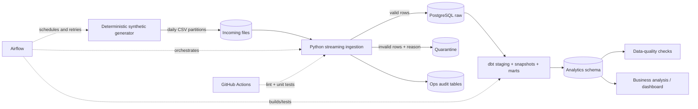

# Recommerce Analytics Platform

An original, production-like data platform for a **synthetic second-hand
marketplace**. It turns incremental CSV deliveries into tested PostgreSQL
analytics marts while demonstrating the reliability work that is often absent
from portfolio pipelines: idempotency, quarantine, auditability, backfills,
SCD Type 2 history, and automated data-quality checks.

> This is an independent portfolio project. It uses generated data and does
> not contain material, data, code, or branding from an employer or marketplace.

## The business problem

Marketplace Operations and Product Analytics need trustworthy answers to:

- How much new supply is created each day?
- Which categories have strong listing engagement and completed-sale outcomes?
- What is the median time from listing creation to sale?
- Which sellers have strong observed sell-through and shorter time-to-sale?
- Can a metric be reproduced after a late file or failed pipeline run?

The project therefore optimises for **correct and explainable metrics**, not
for adding the largest possible number of tools.

## Architecture



The same application commands can be run manually or by Airflow. Airflow is
an orchestrator, not a second implementation of the pipeline.

## Reliability scenarios demonstrated

| Scenario | Expected behaviour |
|---|---|
| The same file is delivered twice | Its SHA-256 checksum is already registered; no raw duplicates are inserted. |
| A listing has a negative price | The row and validation reason are written to quarantine. |
| An order arrives three days late | The delivery is ingested with its original event time; dbt rebuilds downstream marts. |
| A listing changes price/status | A snapshot after each daily batch preserves the versions observed across those runs. |
| A task fails transiently | Airflow retries it; run status and logs remain auditable. |
| A source column changes unexpectedly | Header/contract validation fails early instead of corrupting a mart. |

## Technology choices

- **Python 3.11+** — deterministic generation, streaming validation and ingestion
- **PostgreSQL** — raw records, operational metadata and analytical storage
- **dbt** — transformations, documentation, tests and SCD Type 2 snapshots
- **Airflow** — scheduling, dependency management, retry and backfill
- **Docker Compose** — reproducible local environment
- **pytest + Ruff + GitHub Actions** — automated quality gates
- **pandas** — business-facing analysis after the warehouse has done the heavy transformation

Kafka and Kubernetes are intentionally excluded from the MVP. Daily batch
files do not justify streaming infrastructure, and a single-machine portfolio
deployment does not require a container orchestrator. See
[`docs/tradeoffs.md`](docs/tradeoffs.md).

## Repository map

```text
airflow/       orchestration DAGs
analysis/      business questions and reusable SQL
dashboard/     optional presentation layer
dbt/           sources, staging, snapshots, facts, dimensions and marts
docs/          architecture, runbook and learning material
sql/           database bootstrap objects
src/           generator, ingestion, DQ and analytics application code
tests/         fast unit tests
```

## Quick start

Prerequisites: Docker Desktop (or Docker Engine with Compose), Git and `make`.

```bash
cp .env.example .env
make demo
```

`make demo` is the intended end-to-end entry point. It processes two daily
batches separately so dbt can preserve a real price/status change as SCD Type
2 history, runs all models and tests, executes the persisted quality gate,
exports business metrics, and finally replays the second partition to prove
that its checksum produces zero duplicate inserts.

Useful development commands are documented by:

```bash
make help
```

On Linux, set `APP_UID`, `APP_GID`, and `AIRFLOW_UID` in `.env` to match the
owner of the checkout if your user ID is not `1000`. The runbook also covers
builds behind a corporate certificate authority.

For a lower-disk alternative, run Python/dbt locally and Docker only for
PostgreSQL. After configuring `.env` for `localhost`:

```bash
python -m venv .venv
.venv/bin/python -m pip install -e '.[dev,warehouse]'
docker compose up -d --wait postgres
.venv/bin/python scripts/demo_local.py --users 100 --listings 200
```

This fallback passed the two-day end-to-end run. Full Compose app-container
execution was blocked by the development host's Docker VFS disk limit;
Airflow received static checks only. See the precise tested/unverified
boundaries and measured results in [verification.md](docs/verification.md).
If Docker is unavailable entirely, provide a reachable PostgreSQL instance
instead. Recovery procedures are in [`docs/runbook.md`](docs/runbook.md).

## Data layers

- `raw`: validated, append-only source versions with lineage metadata.
- `quarantine`: rejected payload, reason, file and ingestion time.
- `ops`: processed-file registry, pipeline runs and DQ outcomes.
- `snapshots`: dbt-managed historical entity versions.
- `analytics`: business-ready dimensions, facts and marts.

Definitions and grains are in [`docs/data-model.md`](docs/data-model.md).

## What this project proves

This repository is intended to support a junior Data/Analytics Engineer
interview. It demonstrates that I can:

1. translate business questions into data grains and metrics;
2. build incremental, replayable ingestion rather than a one-off notebook;
3. protect analytics from invalid inputs;
4. model historical changes and late-arriving data;
5. automate tests and explain operational recovery;
6. make proportionate architecture decisions and document trade-offs.

It is a realistic simulation, **not a claim of operating a real company's
production platform**. Constraints and next steps are stated explicitly.

## Current boundaries

- Ingestion processes new deliveries incrementally; dbt analytical tables are
  rebuilt in full at this portfolio scale.
- Dimensions and facts use the latest known entity state. Snapshots are stored
  separately; the marts do not yet perform historical as-of dimension joins.
- Snapshot history begins when a version is observed by a snapshot run. Loading
  all past files before the first snapshot does not reconstruct every past change.
- The listing funnel reports observed stage flags and event counts, rather than
  a time-ordered user conversion funnel. Sell-through uses observed listings and
  has no fixed N-day maturity window.
- CI is provided. Cloud deployment, routed alerts, HA and backup/restore
  automation are future work.

## Development and attribution

Developed with AI assistance for implementation, review and documentation.
The project is intended to be run, inspected and extended by its presenter;
AI-generated code is not a substitute for understanding the design or
validating its behaviour. No employment or commercial impact is implied.

## Documentation

- [Start here: learning and presentation plan (Turkish)](docs/start-here-tr.md)
- [Architecture](docs/architecture.md)
- [Business case and metric definitions](docs/business-case.md)
- [Data model and dictionary](docs/data-model.md)
- [Operations and failure recovery](docs/runbook.md)
- [Verification results and reproducible local fallback](docs/verification.md)
- [Architecture trade-offs](docs/tradeoffs.md)
- [Step-by-step learning guide (Turkish)](docs/learning-guide-tr.md)
- [Interview guide](docs/interview-guide.md)
- [Glossary](docs/glossary.md)

## Licence

MIT. All generated records are synthetic and contain no real personal data.
