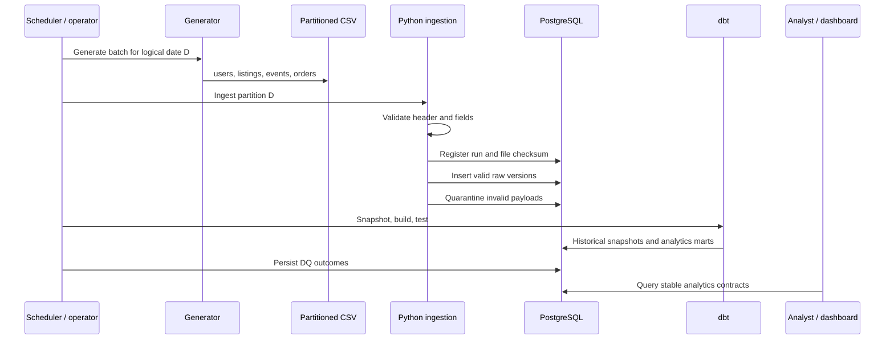

# Architecture

## Design objective

The platform is designed around one question: **can a daily marketplace metric
be trusted and reproduced?** A chart is the last step. Before it, the platform
must know which file was processed, which rows were rejected, which entity
versions were observed at successive snapshot runs, and whether the run passed
its checks. Current analytical models do not yet use historical as-of joins.

## End-to-end flow

## Component responsibilities

### Synthetic generator

- Uses a fixed seed so a reviewer can reproduce the same batch.
- Creates relationships between buyers, sellers, listings, events and orders.
- Injects a small, documented number of bad and late records.
- Avoids names, emails and other real-looking personal data.

It is a test-data producer, not part of the analytical truth layer.

### Python ingestion

- Streams CSV rows instead of reading an entire delivery into memory.
- Validates the file contract and domain rules.
- Calculates a SHA-256 checksum for file-level idempotency.
- Writes valid rows and quarantined rows in one transaction.
- Records run/file status, counts, lineage and timestamps.

Streaming ingestion is deliberate: pandas is excellent for analysis, but a
file loader should not require memory proportional to the complete file.

### PostgreSQL

PostgreSQL is both the operational store for this local simulation and its
warehouse. Schemas separate concerns so that raw ingestion, rejected data,
operational metadata and analytics do not become one undifferentiated database.

### dbt

- Sources declare the raw contract.
- Staging models standardise and deduplicate records.
- Snapshots preserve mutable listing/user history.
- Dimensions and facts establish documented grains.
- Marts encode reusable business definitions.
- Tests stop invalid analytical outputs from being silently published.

Staging and current dimensions select the latest source version. The fact and
mart tables are rebuilt in full. Snapshots preserve states observed between
runs; they are not a complete source CDC history or bitemporal model.

### Airflow

Airflow calls the same CLI used by a local operator. It adds scheduling,
dependencies, retries and historical backfills. Business transformation logic
does not live inside the DAG.

### Analysis layer

SQL performs set-based aggregation in PostgreSQL. pandas consumes appropriately
sized result sets to produce a human-readable summary or visualisation. This
separation avoids downloading raw warehouse tables merely to group them again.

## Idempotency model

Idempotency exists at two levels:

1. **File level:** a completed checksum is not processed again.
2. **Record level:** stable business/version keys or row hashes prevent a
   replay under a different filename from multiplying raw records.

An operator can therefore retry after uncertainty without first deleting data.

## Time semantics

- All timestamps are UTC.
- `event_at`, `order_at`, and `created_at` describe business event time.
- ingestion timestamps describe processing time.
- A logical batch date is not assumed to equal the event date.

Keeping these concepts separate is what allows a late-arriving order to be
represented honestly.

## Security and privacy boundary

- Only synthetic identifiers such as `usr_000123` are generated.
- Secrets are read from environment variables.
- `.env` and generated deliveries are excluded from Git.
- Logs must not emit credentials or complete rejected payload collections.
- The local database password in `.env.example` is an example, not a secret.

## Deployment boundary

Docker Compose is a reproducible local deployment, not high availability. A
real managed deployment would add separate credentials, encrypted transport,
backups, restricted network access, workload identities, alert routing and an
external secrets manager.
