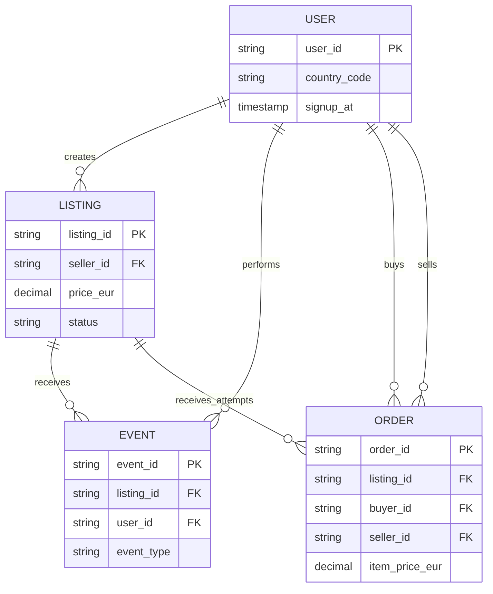

# Data Model and Dictionary

## Modelling rules

- Raw tables preserve source versions and lineage.
- Staging models choose a clean representation without applying business KPIs.
- Dimensions describe entities; facts describe events at an explicit grain.
- Marts contain reusable business definitions rather than dashboard-specific SQL.

## Source entities

### users

Grain: one delivered version of a marketplace user.

| Column | Meaning |
|---|---|
| `user_id` | Synthetic stable business identifier |
| `country_code` | Two-letter market code from the allowed set |
| `signup_at` | UTC account creation timestamp |
| `acquisition_channel` | Organic, paid, referral or partner acquisition |
| `is_business` | Whether the seller operates as a business account |
| `updated_at` | Source change timestamp used for version ordering |

### listings

Grain: one delivered version of a listing.

| Column | Meaning |
|---|---|
| `listing_id` | Stable synthetic listing identifier |
| `seller_id` | User who owns the listing |
| `category` | Controlled marketplace category |
| `brand_tier` | Simplified value tier; not a real brand |
| `item_condition` | Controlled condition value |
| `price_eur` | Item price excluding shipping |
| `status` | `active`, `reserved`, `sold`, or `removed` |
| `created_at` | First publication time |
| `updated_at` | Source change timestamp |

### events

Grain: one immutable user/listing interaction.

| Column | Meaning |
|---|---|
| `event_id` | Unique event identifier |
| `listing_id` | Interacted listing |
| `user_id` | Synthetic actor identifier |
| `session_id` | Groups events from one visit |
| `event_type` | `view`, `favorite`, `message`, or `price_drop` |
| `event_at` | Business event timestamp |

### orders

Grain: one delivered version of an order.

| Column | Meaning |
|---|---|
| `order_id` | Stable order identifier |
| `listing_id` | Purchased listing |
| `buyer_id` | Purchasing user |
| `seller_id` | Selling user, retained for validation and analysis |
| `order_at` | Original order timestamp |
| `item_price_eur` | Agreed item value |
| `shipping_eur` | Shipping charged separately |
| `payment_method` | Synthetic payment category |
| `order_status` | Current delivered order state |
| `updated_at` | Source change timestamp |

## Operational schemas

### `ops.processed_files`

One row per successfully processed entity/checksum. It stores source path,
SHA-256, file size, observed/accepted/rejected counts, run ID and processing
timestamp. Logical delivery date is encoded in the source path; there is no
separate logical-date or file-status column.

### `ops.pipeline_runs`

One row per ingestion CLI execution, with status, start/end time, error summary and
batch context. It answers “what happened?” without searching application logs.

### `ops.data_quality_results`

One row per check execution: check name, severity, observed value, threshold,
pass/fail result, run identifier and timestamp.

### `quarantine.invalid_records`

One row per rejected source record. It includes the source file, entity,
line/row context, reason, original JSON payload and ingestion timestamp.

## Analytical contracts

The implemented grains are:

- `analytics.dim_users`: one current row per user.
- `analytics.dim_listings`: one current row per listing.
- `analytics.dim_date`: one calendar date covering observed source time bounds.
- `analytics.fct_listing_events`: one immutable event.
- `analytics.fct_orders`: one order at its latest state, with monetary measures.
- `analytics.mart_daily_marketplace_kpis`: one reporting date.
- `analytics.mart_seller_performance`: one seller and seller-country group over the observed data.
- `analytics.mart_listing_funnel`: one listing with aggregate engagement and outcome flags.
- `snapshots.users_snapshot` / `snapshots.listings_snapshot`: versions observed
  by successive snapshot runs, with `dbt_valid_from` and `dbt_valid_to`.

The current dimensions are separate from the snapshots. Facts use current
dimension keys; historical as-of joins are not implemented. Timestamp snapshots
cannot reconstruct an intermediate version never observed by a snapshot run.

## Relationship overview

## Important quality rules

- IDs required by the entity grain are non-empty.
- A seller and buyer must exist in the user source.
- An event/order listing must exist.
- A buyer cannot purchase their own listing.
- Price and shipping values cannot be negative.
- Enumerated values must belong to their contract.
- An update cannot precede entity creation.
- Business keys are unique at the selected current-state grain.
